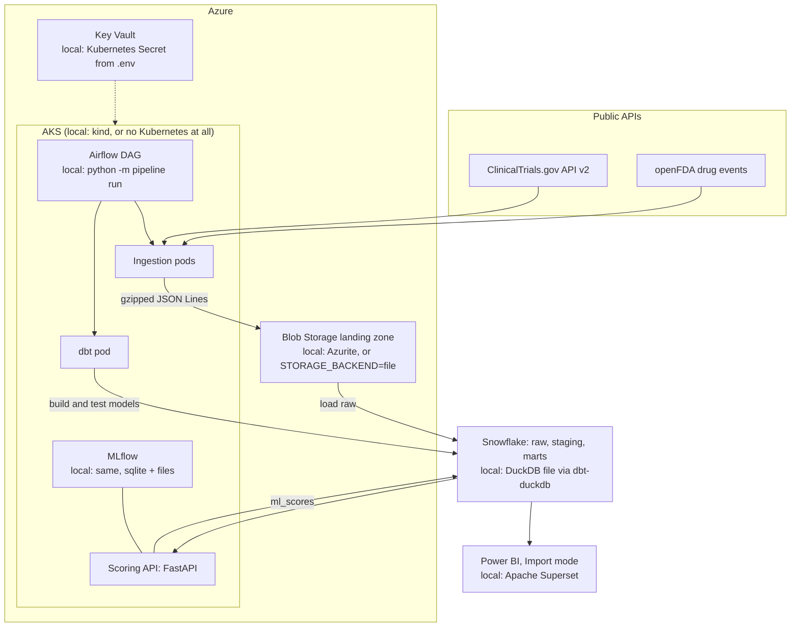
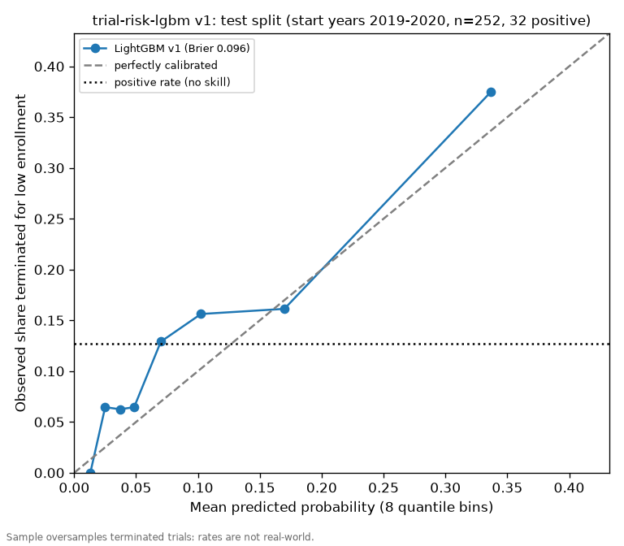

# Trial Risk: predicting low-enrollment terminations on ClinicalTrials.gov

A data platform that ingests public ClinicalTrials.gov and openFDA data, models it with dbt, trains a classifier that
estimates which interventional trials end in termination for low enrollment, serves the model over an API, and
defines dashboards on the result. It is written to run on a cloud stack (Azure, AKS, Snowflake, Power BI) and on an
open-source local stack (DuckDB, MLflow, FastAPI, Superset) from the same code.

This is an analytics and engineering exercise. It is not decision support for real trials.

## Status: what has and has not been run

Read this before the rest. The project was built on one Windows 11 ARM64 machine with no Docker, no Kubernetes tools
and no cloud accounts. So there are two tiers.

| Tier | Components | Status |
|---|---|---|
| Executed on the build machine | Ingestion against the live APIs (to build the sample snapshot), loader, dbt build and tests on DuckDB, model train / evaluate / score, FastAPI service (tested in-process with `TestClient`, and by starting `uvicorn` and calling it with `curl`), `python -m pipeline run --source sample` end to end, the unit and static test suite | Run |
| Written and statically checked only | Docker images, kind, Helm charts, Airflow DAGs, OpenTofu, Azure, the Snowflake target of dbt and the Snowflake / Azure code paths in Python, GitHub Actions workflows, Superset import, Power BI Desktop | **Not run anywhere** |

- No real cloud deployment has happened. Nothing has been pushed to GitHub, so the CI workflows have never executed.
- There are no screenshots and no screen recording. Neither dashboard bundle has been opened in its tool.
- Every metric below comes from a 3,015-study sample that deliberately oversamples terminated trials. They are
  pipeline smoke results, not real-world estimates.
- Label precision is **unmeasured**. The 200-example hand check has not been done (see [The label](#the-label)).

A checklist of what to verify first on a machine that has the tools is in [Verify on first real run](#verify-on-first-real-run).

## Architecture

Cloud mode (target design). The text after "local:" names what replaces each component in local mode.



Data flow, one daily batch run: pull both APIs to the landing zone, load raw tables, check source freshness
(`dbt source freshness`, Airflow only), `dbt build` (staging, marts, tests), score all open trials with the registered
model into `marts.ml_scores`, rebuild the marts that read the scores, refresh the dashboard (Power BI, cloud only; not
run). Raw data is never edited, so any layer can be rebuilt from it.

### What swaps in local mode

| Layer | Cloud | Local, no Docker (verified) | Local, Kubernetes (unverified) |
|---|---|---|---|
| Orchestration | Airflow on AKS | `python -m pipeline run` (in-process) | Airflow on kind |
| Landing storage | Azure Blob | `STORAGE_BACKEND=file`, directory `data/landing` | Azurite |
| Warehouse | Snowflake | DuckDB file | DuckDB file on a PersistentVolumeClaim |
| BI | Power BI (Import mode) | Superset bundle (import not run) | Superset bundle only: Superset is not deployed by `local-up`; install it by hand per `bi/superset/README.md` |
| Secrets | Key Vault | `.env` | Kubernetes Secret from `.env` |
| Infrastructure as code | OpenTofu | not needed | not needed |

The switch is `MODE=local|cloud` (warehouse and dbt target) and `STORAGE_BACKEND=file|azure`, read through
`common/config.py`. Airflow, dbt Core, MLflow, FastAPI, LightGBM, scikit-learn and Helm are the same in both modes.

## Quick start (no Docker, verified)

Needs Python 3.12 and [uv](https://docs.astral.sh/uv/). Run from the repo root. `make` is optional; the `uv run`
commands below are what the Makefile targets call. Defaults come from `.env.example` (copy it to `.env` if you want
to change them): `STORAGE_BACKEND=file`, DuckDB at `data/warehouse/trialrisk.duckdb`, MLflow in
`data/mlflow/mlflow.db`. On the Windows ARM64 build machine the uv environment uses an x86-64 CPython 3.12 (run under
Windows' x64 emulation), not a native ARM64 build.

```bash
git clone <your-fork>
cd <your-fork>

uv sync --all-extras                               # make setup
uv run python -m pipeline run --source sample      # make run
```

`pipeline run --source sample` loads the committed snapshot into raw tables, runs `dbt build` (157 models and tests,
all passing on the build machine), trains the model if none is registered, scores the open studies, and rebuilds the
marts that read the scores. On the build machine this took about 50 seconds from an empty warehouse and an empty
MLflow store. It prints a row count for every table. Re-running is safe: the loader skips files it has already
loaded, the registered model is reused (pass `--retrain` to train again), and each run appends to `marts.ml_scores`
(`marts.ml_scores_latest` keeps the newest score per study).

Then, optionally:

```bash
# Re-evaluate the registered model. Without --out-dir this overwrites docs/model_metrics.json
# and docs/img/calibration.png.
uv run python -m ml evaluate --out-dir data/mlflow/eval

# Serve the model, then score a trial by NCT id.
uv run uvicorn serving.app:app --port 8000
curl localhost:8000/health
curl -X POST localhost:8000/score -H "content-type: application/json" \
     -d '{"nct_ids": ["NCT04924491"]}'

# Tests. Slow: the dbt, pipeline and serving tests build real warehouses.
uv run pytest
```

`POST /score` also accepts raw feature rows (`{"features": [{...}]}`) and returns the risk score and the top three
SHAP drivers per trial. `POST /score/batch` re-scores all open studies into `marts.ml_scores`.

Other entry points: `python -m ingestion {ctgov,fda,load,sample}` (the live pull, openFDA pull, loader and the sample
rebuild; they need network access), `python -m ml {train,evaluate,score,label-sample,label-precision}`, and
`python -m pipeline run --source live` (live pull then the same chain; not run on the build machine).

### openFDA API key

openFDA works without a key but is capped at 1,000 requests per day. A free key (self-serve, no approval:
<https://open.fda.gov/apis/authentication/>) raises that to 120,000 per day. Put it in `.env`:

```
OPENFDA_API_KEY=<your key>
```

Without a key the daily cap is not tracked across runs. A second same-day run skips drugs already fetched and stops
cleanly on HTTP 429.

## Other ways to run it (not run)

### Local Kubernetes: kind + Azurite + Airflow

```bash
make local-up        # bash deploy/local-up.sh
make local-down
```

Needs docker, kind, kubectl, helm and openssl. The script builds three images (pipeline, serving, Airflow with the DAGs
baked in), creates a kind cluster named `trial-risk`, writes a Kubernetes Secret from `.env`, and installs the
`trial-risk` Helm chart and the official Airflow chart. Serving is mapped to `localhost:8000` and the Airflow web UI to
`localhost:8080`. **None of this has been run.**

The Airflow DAGs (`dags/trial_risk_daily.py`, one Kubernetes pod per task):

- `trial_risk_daily` (daily): `ingest_ctgov` → `ingest_fda` → `load_raw` → `source_freshness` → `dbt_build`
  → `score` → `refresh_marts`. It scores with the registered model and **does not train**.
- `trial_risk_train` (manual): `python -m ml train`.
- `trial_risk_sample` (manual): `python -m pipeline run --source sample` in one pod (load the committed sample, dbt
  build, train and register a model if none exists, score).

Bootstrap order after `make local-up`: trigger `trial_risk_sample` in the Airflow UI (or run `trial_risk_daily` until
`dbt_build` succeeds, then trigger `trial_risk_train`) **before** relying on the daily DAG's `score` step, which fails
while no model is registered. The first daily run has no ClinicalTrials.gov watermark yet, so `ingest_ctgov` does a full
backfill of about 500 API pages; later runs are incremental.

Superset is **not** deployed by `local-up`. The dashboard bundle has to be installed and imported by hand, per
`bi/superset/README.md`, against the DuckDB file on the `trial-risk-warehouse` volume.

State lives on PersistentVolumeClaims in the kind cluster (DuckDB file, MLflow registry, Azurite blobs), so it survives
pod restarts and re-runs of `local-up`. To reset everything, delete the cluster (`make local-down`, or
`kind delete cluster --name trial-risk`).

### Cloud: Azure, AKS, Snowflake, Power BI

```bash
cp deploy/tofu/terraform.tfvars.example deploy/tofu/terraform.tfvars   # fill in (git-ignored)
export TF_VAR_snowflake_password=...              # never in a file
GHCR_OWNER=<your-github-owner> SNOWFLAKE_ACCOUNT=<orgname-accountname> SNOWFLAKE_USER=TRIAL_RISK_SVC \
  make cloud-up                                   # OpenTofu apply, AKS credentials, Helm
make cloud-down                                   # OpenTofu destroy
```

`cloud-up` stops early if `GHCR_OWNER`, `SNOWFLAKE_ACCOUNT` or `SNOWFLAKE_USER` is unset. OpenTofu state
(`deploy/tofu/terraform.tfstate`) is written locally and holds the Snowflake password and storage key in plaintext; it
is git-ignored, keep it that way.

Also needed: `deploy/snowflake/setup.sql` run by hand in a Snowflake account (placeholders for tenant and storage
account), then the Power BI project in `bi/powerbi/` opened in Power BI Desktop (Windows only). **None of this has been
run.**

Snowflake sign-in is password-only today (`common/warehouse.py`, `dbt/profiles.yml`, Key Vault). Snowflake is retiring
single-factor password sign-in, so key-pair authentication will likely be needed before the first cloud run; it is
**not wired yet**.

### Verify on first real run

The unverified pieces, in the order to try them. Expect to fix things at each step.

1. `docker build` for the three images in `deploy/docker/` (`pipeline`, `serving`, `airflow`). They assume `uv.lock`
   and the app directories exist in the build context and that the `cloud` extra installs. The pipeline and serving
   images copy uv from `ghcr.io/astral-sh/uv:0.11.19`, the uv version that wrote `uv.lock`; that the tag exists on
   GHCR is unconfirmed (an older uv may reject the lock file in `uv sync --frozen`).
2. `helm lint` and `helm template` for `deploy/helm/trial-risk` with both `values-local.yaml` and `values-aks.yaml`
   (also with `--set keyVault.enabled=true`). Then `helm template` for the official Airflow chart (pinned to 1.15.0,
   Airflow 2.10.5) with `deploy/helm/airflow-values-*.yaml`: confirm the keys are accepted and that the PostgreSQL
   image override (`bitnamilegacy/postgresql`) actually pulls.
3. `kind create cluster --config deploy/kind/cluster.yaml`, then `deploy/local-up.sh`. Watch MLflow against Azurite
   through a `wasbs://` artifact URI, the Airflow `rollout restart` deployment names, and the DuckDB PVC permissions
   (the pods run as uid 10001).
4. `tofu -chdir=deploy/tofu init && tofu validate && tofu plan`. The azurerm 4.x attribute names and the
   subscription-scoped budget are the likely failures. One `Standard_B2s` node (2 vCPU, 4 GiB) may be too small for
   Airflow + Postgres + MLflow + serving + the task pods at once.
5. Snowflake authentication: password-only sign-in for `TRIAL_RISK_SVC` will probably be rejected on a new account
   (single-factor password retirement). Key-pair authentication will likely be needed before the first cloud run and is
   not wired yet (see the comment at the user in `deploy/snowflake/setup.sql`).
6. Review `deploy/snowflake/setup.sql` in a Snowflake trial account, then the first `dbt build --target cloud`. The
   Snowflake branches of the dbt macros (JSON paths, `FLATTEN`, regex, identifier case) have only been parsed and
   compiled, never executed. Also check the leakage test and source freshness on Snowflake.
7. First Snowflake run of the Python paths in `common/` (`write_pandas` identifier handling) and `ingestion/load.py`
   (the staging-table + `parse_json` insert used for the sample load, and the `COPY INTO` path), and the cloud
   branches of the pipeline and serving.
8. First Airflow run of the three DAGs (`trial_risk_sample`, `trial_risk_daily`, `trial_risk_train`); first push of
   the GitHub Actions workflows (action versions were written from memory); first import of the Superset bundle.
9. First open of `bi/powerbi/TrialRisk.pbip` in Power BI Desktop and first Snowflake refresh. The PBIR and TMDL schema
   versions were written from memory, and the both-direction relationships may produce ambiguity warnings.

## Results

All numbers are from `docs/model_metrics.json` (run `7bfd12b83a224a67852a7acab5ff0b2b`, `trial-risk-lgbm` version 1,
reproduced on a clean store, see the model card). The sample oversamples terminated trials, so the positive rates and
PR-AUC values below do not describe the real registry, and the probabilities are not real-world probabilities.

Time-based split by `start_year`: train up to 2016, validation 2017-2018, test 2019-2020. Later years and rows without a
start year are dropped. PR-AUC (average precision) is the headline metric.

| Split | Rows | Positives | No-skill PR-AUC | LightGBM PR-AUC | Logistic PR-AUC |
|---|---|---|---|---|---|
| train (<= 2016) | 1,168 | 178 | 0.152 | 0.947 | 0.560 |
| validation (2017-2018) | 260 | 40 | 0.154 | 0.316 | 0.306 |
| test (2019-2020) | 252 | 32 | 0.127 | 0.412 | 0.431 |

- Both models are above the no-skill rate on validation and test. The test set has only 32 positives, so the gap
  between the two models is within noise.
- LightGBM does not beat logistic regression on the test split (0.412 vs 0.431 PR-AUC; ROC-AUC 0.758 vs 0.778). It does
  slightly better on validation, also within noise.
- LightGBM overfits the training years: train PR-AUC 0.947 against 0.316 on validation.
- Test, LightGBM: Brier 0.096, log loss 0.329, ECE 0.032 (8 quantile bins).
- Predicted probabilities run low on recent cohorts: mean predicted 0.117 against an observed rate of 0.154 on
  validation, and 0.101 against 0.127 on test. No recalibration is applied in v1
  ([ADR 0006](docs/adr/0006-no-recalibration-in-v1.md)).
- Highest global SHAP on test (mean absolute value): `condition_category` 0.412, `healthy_volunteers` 0.330,
  `us_only` 0.246, `phase` 0.241, `max_age_years` 0.222.



Full details, including the calibration table and limitations, are in the [model card](docs/model_card.md).

### The label

A closed interventional study (status COMPLETED or TERMINATED) is labelled by `dbt/macros/low_enrollment.sql`:

- **1 (low enrollment)**: TERMINATED and the lower-cased `whyStopped` text matches a *shortfall* pattern, **or**
  matches an enrollment *stem* (`accru`, `recrui`, `recuit`, `recrut`, `enrol`) **and does not** match an *exclusion*
  pattern. The shortfall pattern covers explicit statements such as "slow recruitment", "enrollment target not
  reached" and "only N subjects were recruited". The exclusion pattern removes completed-enrollment and
  stopped-enrollment shapes such as "enrollment was complete", "met enrollment targets" and "enrollment was
  prematurely stopped".
- **0**: COMPLETED.
- Not labelled (excluded from training): terminated for other reasons, and WITHDRAWN.

Current counts in the sample: 1,430 completed (0), 250 terminated for low enrollment (1), 335 terminated for other
reasons, 60 withdrawn. Of the 585 TERMINATED studies, 60 have no `whyStopped` text.

**Precision is unmeasured.** `docs/label_check/sample.csv` holds 200 studies (100 regex matches and 100 non-matches,
columns `nct_id, why_stopped, regex_match, human_label`). It has been generated but nobody has labelled it. To measure
precision: fill `human_label` with `1` (the stop reason is low enrollment) or `0` (any other reason) for each row, then

```bash
uv run python -m ml label-precision          # reads docs/label_check/sample.csv; --path to use another file
```

It prints the precision on the labelled matches and the share of low-enrollment trials among the labelled
non-matches. Until then the command fails with "no regex matches have a human_label yet".

Known remaining false-positive shapes, found by reading examples while writing the rule:

- "Recruitment halted under COVID restrictions"
- "Enrollment stopped due to safety issue"
- "enrollment ended after reaching goal"
- "ended enrollment early for toxicity"

Other texts that still match without being shortfall reasons include funding-and-recruitment mixes ("Lack of funds to
continue and volunteer recruitment member left position") and "Early termination leading to small number of subjects
analyzed".

## Leakage

The biggest risk to a model like this is features that encode the outcome. What the project does about it:

**Fields that are never features, and why**

| Field | Why excluded |
|---|---|
| `enrollmentInfo.count` and `.type` | Overwritten with the actual count when a trial closes, so on closed trials it largely encodes the answer |
| Completion dates, and any duration derived from them | Flip from ESTIMATED to ACTUAL at close; planned duration computed from the current record leaks the same way |
| `lastUpdatePostDate` | A record-maintenance outcome, not a registration-time fact |
| Results-posted flags (`hasResults`) | Posted only after a trial finishes |
| `whyStopped` | It is the label source |

**Controls**

- Features are an explicit list in `ml/features.py` (7 categorical, 20 numeric; the model card lists them). A test
  walks the dbt lineage upstream of `ml_features` and fails if any model other than `stg_studies` reads a forbidden JSON
  path, and traces which `stg_studies` columns feed the features. A name-pattern guard rejects feature names that look
  like end dates, actual values, termination or withdrawal fields.
- **Time-based split by start year** (train up to 2016, validation 2017-2018, test 2019-2020, later years dropped), so
  that recent trials that are already closed, which skew toward early stops, do not set the test score
  ([ADR 0004](docs/adr/0004-time-based-split.md)).
- **PR-AUC guard**: `python -m ml train` refuses to register a model whose test PR-AUC exceeds 0.95 unless
  `--allow-suspicious` is passed. Test PR-AUC here is 0.412.

**Soft leaks that remain, on purpose or because the public API gives no alternative**

- Every feature is read from the *latest* version of the study record, not the version first registered. Sites (behind
  `n_sites`, `n_countries`, `us_only`), arms, interventions, conditions and their MeSH category, eligibility criteria and
  the age range can all be edited after registration. The site count is the known soft leak from the design doc, kept
  on purpose.
- `start_year` mixes ACTUAL and ESTIMATED start dates.
- The planned (registration-time) enrollment number would be a strong legitimate feature, but it is not available from
  the public API (an open question below).

## Data caveats

- About 20% of sample studies (601 of 3,015) have condition category `Unknown`. 598 of them have no MeSH browse data in
  the record. The category is derived from MeSH ancestors because the API no longer returns browse branches.
  `condition_category` is also the highest-SHAP feature, so this matters.
- The drug-safety match rate on the sample is about 3% (57 of 1,924 drugs in `dim_drug`). Only the 60 most common
  drug names were fetched from openFDA, and non-drug intervention names remain in the intervention list. The match rate
  is shown on the dashboards.
- openFDA gives no report total, so "report volume" on the drug-safety page is the sum of counts over the listed
  reactions, not the number of reports.
- The sample snapshot (3,015 studies, 60 drugs) is documented in [data/sample/README.md](data/sample/README.md). It
  oversamples terminated trials: 585 of 3,015 studies are TERMINATED and every start year 2008-2020 has 110 COMPLETED
  and 45 TERMINATED studies. ClinicalTrials.gov and openFDA data are U.S. government works; do not use this snapshot for
  clinical decisions.

## Cost guardrails (defined, not exercised)

The design target is $0 in local mode and a capped spend in cloud mode. These are written in code but have not run:

- Snowflake: one X-Small warehouse with `AUTO_SUSPEND = 60`, and a resource monitor (5-credit monthly quota) that
  suspends at 75% and immediately at 100% (`deploy/snowflake/setup.sql`).
- AKS: free control-plane tier, one `Standard_B2s` node, region `eastus2` (`deploy/tofu/`). Between sessions the
  cluster can be paused with `az aks stop --resource-group <rg> --name <cluster>` (and resumed with `az aks start`),
  which stops node compute charges without destroying anything; storage and Key Vault still bill.
- Azure: a $25 monthly budget scoped to the subscription, so spend in the AKS node resource group is covered, with
  email alerts at 50%, 80% and 100% of actual spend.
- `make cloud-down` runs `tofu destroy`.
- Power BI uses Import mode so that clicks do not wake the warehouse ([ADR 0003](docs/adr/0003-import-mode-over-directquery.md)).

## Differences from the design doc

The design doc is `docs/design-doc.pdf`. Where the build departs from it:

| Change | Reason |
|---|---|
| `file` storage backend added | Run the whole pipeline with no Docker ([ADR 0005](docs/adr/0005-file-storage-backend.md)) |
| `common/` and `pipeline/` packages added | Shared settings, storage and warehouse code; an in-process runner for the no-Kubernetes path |
| Bridge tables `bridge_study_condition` and `bridge_study_drug` | Studies have many conditions and drugs; many-to-many relationships need a bridge |
| Condition category derived from MeSH ancestors | The API no longer returns browse branches |
| `ml_scores` written by the scoring job and exposed as `ml_scores_latest` | Scores are produced outside dbt; the view gives BI one row per study |
| DAGs baked into a derived Airflow image | Avoids a git-sync dependency; the image is rebuilt when DAGs change |
| Azure budget scoped to the subscription | A resource-group budget would miss the AKS node resource group |
| Synthea and RxNorm left out of v1 | Both were stretch goals in the design doc |
| No planned-vs-actual enrollment in `fct_trial_outcomes` | The registry overwrites the planned enrollment count with the actual one when a trial closes, so the planned number is not available from the public API |
| An intermediate dbt layer (`dbt/models/intermediate/`) between staging and marts | The condition-category derivation and the study-drug list are each used by several marts |
| Dockerfiles under `deploy/docker/` | Keeps all deployment files in `deploy/` |
| No `ml/notebooks/` | Analysis lives in the `python -m ml` commands, the model card and `docs/model_metrics.json` |
| `make local-up && make run` does not by itself produce dashboards | `make run` builds the marts with the no-Docker path; Superset is not deployed by `local-up` and the bundle is imported by hand (`bi/superset/README.md`); Power BI is cloud only |
| CI runs the pipeline twice, in different places | The fast `pipeline-sample` job runs it on the runner (no cluster); the `kind-e2e` job runs the same command in-cluster as a Job and then checks the API's `/health` |

## Open questions (from the design doc, still open)

- Can the planned (registration-time) enrollment number be recovered from the record's version history through a public
  endpoint? If so, it is the strongest legitimate feature for v2.
- Score all open trials or only industry-sponsored ones? Currently all open trials (RECRUITING and
  NOT_YET_RECRUITING) are scored.
- Is the dashboard for a trial operations lead or a portfolio strategist? That decides page 2's default sort and
  filters. Currently the default is all open trials sorted by risk score. It is one line to change in each dashboard
  bundle (see `bi/superset/README.md` and `bi/powerbi/README.md`).

## Repo map

```
common/        settings (common/config.py), storage (file, Azure Blob), warehouse (DuckDB, Snowflake)
ingestion/     ClinicalTrials.gov and openFDA clients, loader, sample builder; python -m ingestion
dbt/           models (staging, intermediate, marts), macros with adapter dispatch, tests, MeSH seed
ml/            features, labels, split, train, evaluate, score, MLflow registry; python -m ml
serving/       FastAPI app: POST /score, POST /score/batch, GET /health
pipeline/      in-process end-to-end runner; python -m pipeline run
dags/          Airflow DAGs: trial_risk_daily, trial_risk_train, trial_risk_sample (not run)
deploy/        docker/, helm/, kind/, tofu/, snowflake/, and the local-up / cloud-up scripts (not run)
bi/            powerbi/ (PBIP project) and superset/ (dashboard bundle); neither opened in its tool
data/sample/   committed snapshot: 3,015 studies, 60 openFDA drugs
docs/          design-doc.pdf, model card, ADRs, model_metrics.json, calibration image, label-check sample
tests/         pytest suites per package (executable and static)
.github/workflows/   ci.yml, cd.yml (never run)
```

Warehouse layers: `raw` (API JSON as landed), `staging` (flattened, latest record per study), `marts`
(`dim_study`, `dim_sponsor`, `dim_condition`, `dim_drug`, two bridge tables, `fct_study_sites`, `fct_trial_outcomes`,
`fct_drug_safety`, `ml_features`, `ml_scores`, `ml_scores_latest`).

Docs: [model card](docs/model_card.md), ADRs in [docs/adr/](docs/adr/):
[0001 OpenTofu](docs/adr/0001-opentofu-over-terraform.md),
[0002 DuckDB and dispatch macros](docs/adr/0002-duckdb-local-warehouse-adapter-dispatch.md),
[0003 Import mode](docs/adr/0003-import-mode-over-directquery.md),
[0004 time-based split](docs/adr/0004-time-based-split.md),
[0005 file storage backend](docs/adr/0005-file-storage-backend.md),
[0006 no recalibration](docs/adr/0006-no-recalibration-in-v1.md).

## License

MIT, see `LICENSE`.
