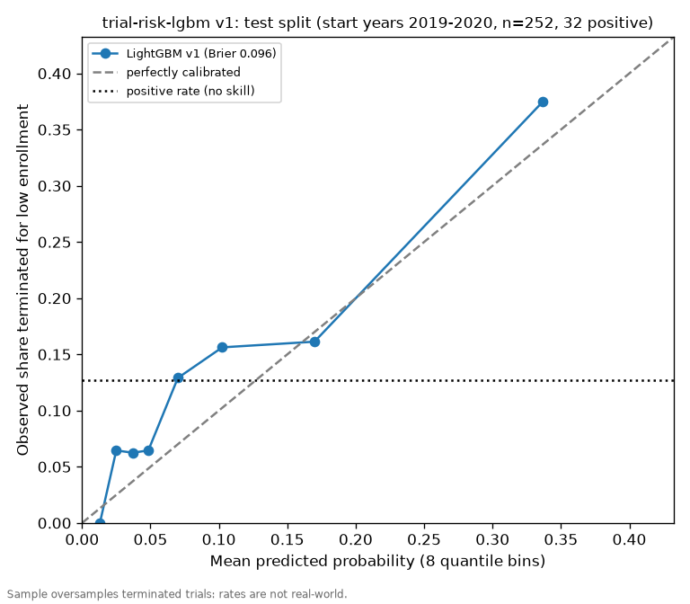

# Model card: trial-risk-lgbm (version 1)

Numbers on this page come from `docs/model_metrics.json` (generated by `python -m ml evaluate`; MLflow run
`7bfd12b83a224a67852a7acab5ff0b2b`, generated 2026-11-14). The metrics were reproduced on a clean MLflow store and
warehouse on the build machine: test PR-AUC 0.412, Brier 0.096, ECE 0.032.

**Read first: the data is a 3,015-study sample that deliberately oversamples terminated trials. Positive rates, PR-AUC
values and absolute probabilities are pipeline smoke results. They do not describe the real registry.**

## Intended use and non-use

Intended use: an analytics and engineering exercise that shows the pipeline from public registry data to a scored
dashboard. Scores can be read as a ranking of open trials by relative enrollment risk, on this sample.

Not for: decision support, trial feasibility, site selection, regulatory or clinical claims, or any decision about a real
trial. The score is not a calibrated real-world probability (see Limitations). openFDA data is unvalidated.

## Model

- Task: binary classification. For an interventional study, predict the probability that it is terminated for low
  enrollment, using fields that are intended to be known at registration.
- Main model: LightGBM. Baseline: logistic regression on one-hot and numeric features. Both are trained and reported;
  the registered model (`trial-risk-lgbm`) is the LightGBM one.
- Tracking: MLflow, with parameters, metrics and the feature lists logged. Loading a registered model checks that its
  feature lists match the current code.
- Explanations: per-study SHAP values (log-odds); the top three drivers are returned by the API and stored with the
  score.

## Data

ClinicalTrials.gov API v2 interventional studies, snapshot built 2026-11-14 (`data/sample/`): 3,015 studies. Every start
year 2008-2020 holds 110 COMPLETED and 45 TERMINATED studies; the rest are RECRUITING (400), NOT_YET_RECRUITING (400),
WITHDRAWN (60), SUSPENDED (40), ACTIVE_NOT_RECRUITING (60) and UNKNOWN (40). Only the closed, labelled studies are used
to train and evaluate. The 800 open studies (RECRUITING and NOT_YET_RECRUITING) are scored. openFDA reaction counts for 60
drugs are used on the dashboards, not as model features.

## Label

Population: studies with status COMPLETED or TERMINATED. Positive (1): TERMINATED and `whyStopped` matches the rule
below. Negative (0): COMPLETED. Terminated-for-other-reasons and WITHDRAWN studies are excluded.

Rule (`dbt/macros/low_enrollment.sql`, applied to the lower-cased text): *shortfall pattern* OR (*enrollment stem*
AND NOT *exclusion pattern*). The stem is `accru|recrui|recuit|recrut|enrol`. The shortfall pattern matches explicit
shortfalls ("slow recruitment", "enrollment target not reached", "only N subjects were recruited"). The exclusion pattern
removes completed-enrollment and stopped-enrollment shapes.

Counts on the sample: 1,430 label 0 and 250 label 1 (1,680 labelled studies); 335 terminated for other reasons; 60
withdrawn.

Precision of the rule is **unmeasured**. The 200-example hand check (`docs/label_check/sample.csv`, 100 matches and 100
non-matches) has not been filled in by a human. Known false-positive shapes: "Recruitment halted under COVID
restrictions", "Enrollment stopped due to safety issue", "enrollment ended after reaching goal", "ended enrollment early
for toxicity". Label noise therefore lowers every metric in an unknown way.

## Features

27 features (`ml/features.py`).

- Categorical (7): `phase`, `allocation`, `masking`, `primary_purpose`, `sponsor_class`, `sex`, `condition_category`.
- Numeric (20): `has_drug`, `has_biological`, `has_device`, `has_procedure`, `has_behavioral`, `has_other_intervention`,
  `has_dmc`, `healthy_volunteers`, `us_only`, `n_arms`, `n_collaborators`, `min_age_years`, `max_age_years`,
  `n_inclusion_criteria`, `n_exclusion_criteria`, `criteria_text_length`, `n_sites`, `n_countries`, `n_conditions`,
  `start_year`.

Excluded on purpose: `enrollmentInfo.count` and its type, completion dates and durations derived from them,
`lastUpdatePostDate`, results-posted flags, and `whyStopped`. A name-pattern guard and a lineage test enforce this.

Soft leaks that remain: all features come from the latest version of the study record, so sites, arms, interventions,
conditions and their MeSH category, eligibility criteria and the age range can reflect edits made after registration.
`n_sites`, `n_countries` and `us_only` are the known soft leak from the design doc, kept on purpose. `start_year` mixes
ACTUAL and ESTIMATED start dates. About 20% of studies have `condition_category = Unknown` because the record has no MeSH
browse data.

## Split

By `start_year`: train up to 2016, validation 2017-2018, test 2019-2020; later years and missing years are dropped. See
[ADR 0004](adr/0004-time-based-split.md).

| Split | Rows | Positives | Positive rate |
|---|---|---|---|
| train | 1,168 | 178 | 0.152 |
| validation | 260 | 40 | 0.154 |
| test | 252 | 32 | 0.127 |

## Metrics

PR-AUC is the headline metric. The no-skill value for PR-AUC is the positive rate of the split.

| Split | No-skill PR-AUC | LightGBM PR-AUC | Logistic PR-AUC |
|---|---|---|---|
| train | 0.152 | 0.947 | 0.560 |
| validation | 0.154 | 0.316 | 0.306 |
| test | 0.127 | 0.412 | 0.431 |

Other metrics:

| Metric | LightGBM val | Logistic val | LightGBM test | Logistic test |
|---|---|---|---|---|
| ROC-AUC | 0.722 | 0.738 | 0.758 | 0.778 |
| Brier | 0.125 | 0.124 | 0.096 | 0.093 |
| Log loss | 0.410 | 0.394 | 0.329 | 0.313 |
| ECE (8 quantile bins) | not computed | not computed | 0.032 | 0.053 |
| Mean predicted probability | 0.117 | 0.135 | 0.101 | 0.116 |
| Observed positive rate | 0.154 | 0.154 | 0.127 | 0.127 |

- Both models are above the no-skill rate on validation and test.
- LightGBM does not beat logistic regression on the test split (PR-AUC 0.412 vs 0.431). It is slightly ahead on
  validation (0.316 vs 0.306). With 32 test positives, neither difference is meaningful.
- LightGBM overfits the training years: train PR-AUC 0.947 and ROC-AUC 0.989, against 0.316 and 0.722 on validation.
- No validation or test metric is near the 0.95 leakage guard.

### Calibration, test split, LightGBM

Eight quantile bins of the test set (`docs/model_metrics.json`, `calibration_test`):

| Predicted range | Studies | Mean predicted | Observed rate |
|---|---|---|---|
| 0.007-0.018 | 32 | 0.013 | 0.000 |
| 0.018-0.031 | 31 | 0.025 | 0.065 |
| 0.031-0.043 | 32 | 0.037 | 0.062 |
| 0.043-0.056 | 31 | 0.048 | 0.065 |
| 0.058-0.088 | 31 | 0.070 | 0.129 |
| 0.088-0.128 | 32 | 0.102 | 0.156 |
| 0.129-0.217 | 31 | 0.170 | 0.161 |
| 0.220-0.751 | 32 | 0.337 | 0.375 |

Each bin has about 31 studies, so the observed rates are coarse.

### Global SHAP, test split (mean absolute value)

`condition_category` 0.412, `healthy_volunteers` 0.330, `us_only` 0.246, `phase` 0.241, `max_age_years` 0.222,
`n_sites` 0.173, `criteria_text_length` 0.155, `n_exclusion_criteria` 0.139. The full list is in
`docs/model_metrics.json` (`global_shap_test`). `condition_category` leads, and a fifth of its values are `Unknown`.

## Limitations

- **Oversampled data.** Terminated trials are oversampled, so absolute probabilities, positive rates and PR-AUC do not
  reflect the registry. The model has not been evaluated on a representative sample or on the full registry.
- **Small evaluation sets.** 32 test positives and 40 validation positives. Differences of a few hundredths in PR-AUC are
  noise.
- **Label precision unknown.** The regex label has not been checked by a human; known false-positive shapes are listed
  above.
- **Overfitting.** LightGBM fits the training years far better than later years (PR-AUC 0.947 train, 0.316 validation).
  No hyperparameter search or regularisation study was done.
- **Probabilities run low on recent cohorts.** Mean predicted is below the observed rate on validation (0.117 vs
  0.154) and test (0.101 vs 0.127). No recalibration is applied in v1
  ([ADR 0006](adr/0006-no-recalibration-in-v1.md)); calibration is to be revisited on the full dataset.
- **Soft leaks.** Features are read from the latest record version, and `start_year` mixes actual and estimated dates (see
  Features). The planned (registration-time) enrollment number, which would be a strong legitimate feature, is not
  available from the public API.
- **Missing data.** About 20% of studies have no MeSH-derived condition category; 45.8% have no maximum age (no upper
  limit stated).
- **Scope.** Interventional studies only. One condition category is assigned per study by a priority rule (1,667
  studies map to more than one category).
- **Serving.** The scoring service has been run only against the local DuckDB warehouse and a file-based MLflow store.
  The Snowflake and Azure paths have not been run.
